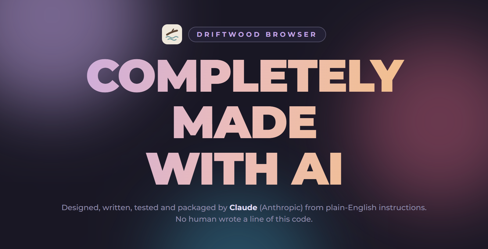

<div align="center">



</div>

<div align="center">

# Driftwood

</div>

<div align="center">

A minimal Android browser built on Firefox's engine, with uBlock Origin built in and real Firefox extensions  
**Every line of it was written by AI.**

</div>

<div align="center">

[](https://github.com/phsrp/Driftwood-browser/releases/latest)  

</div>

## What's inside

- **Ad blocking out of the box:** uBlock Origin installs itself the first time you open the app, and Firefox's own tracking protection is on too
- **Blocking stats:** how many ads and trackers were blocked, in total and on the page you're on (the shield in the address bar)
- **Real Firefox extensions:** add more from Settings → Extensions
- **Address bar at the bottom** that hides when you scroll down, or **at the top** if you prefer (hides when scrolling up)
- **Tabs and incognito tabs**, bookmarks, history and downloads
- **A clean homepage** with shortcuts you can add, rename and remove (long-press one)
- **Google, DuckDuckGo or Bing** as your search engine
- **Themes:** Gruvbox Dark, Gruvbox Light, Rosé Pine and Rosé Pine Dawn, or follow your phone's light/dark mode with a theme of your choice for each
- **Coming from Chrome:** import your bookmarks and passwords, and Google Password Manager can fill logins

## How to download

1. On your phone, open the [latest release](https://github.com/phsrp/Driftwood-browser/releases/latest) (the purple **download** button at the top of this page does the same).
2. Under **Assets**, tap `Driftwood-<version>.apk`.
3. Open the downloaded file and tap **Install**.
4. **If Android says it can't install apps from this source:** tap **Settings**, turn on **Allow from this source**, then go back and tap **Install**. This happens because the app doesn't come from the Play Store.

Needs Android 10 or newer on a 64-bit phone (virtually every phone from the last several years).

### Updating

Download the newest `Driftwood-<version>.apk` from the [latest release](https://github.com/phsrp/Driftwood-browser/releases/latest) and install it the same way. It installs over the old version and **keeps** your tabs, bookmarks, history, passwords and settings.

> **Don't uninstall Driftwood to update it.** Uninstalling deletes everything, including saved passwords.

## What the version numbers mean

Every version is three numbers separated by dots, for example **1.0.1**:

```
  1   .   0   .   1
  │       │       └── minor update: fixes and small improvements
  │       └────────── major update: a big batch of new features (counts from 0 to 9)
  └────────────────── goes up by one when the major number would pass 9
```

- **Minor update (the last number)** goes up for small changes: bug fixes, polish, small additions. `1.0.0` → `1.0.1`.
- **Major update (the middle number)** goes up for a big update with new features, and the minor number starts again from 0. `1.0.1` → `1.1.0`. It counts from 0 up to 9.
- **The first number** only changes when the major number runs out: after `1.9.x` the next big update is `2.0.0`.

So a bigger number on the left always means a newer version: `1.0.1` is newer than `1.0.0`, and `1.1.0` is newer than `1.0.9`.

## Coming from Chrome

**Bookmarks.** Chrome on Android can't export bookmarks, so use Chrome on a computer: **Bookmarks → Bookmark manager → ⋮ → Export bookmarks**. Put the `.html` file on your phone, then in Driftwood: **Settings → Import bookmarks from Chrome**.

**Passwords.** In Chrome on your phone: **Settings → Google Password Manager → Settings → Export passwords**. That saves a `.csv` file. In Driftwood: **Settings → Import passwords from Chrome** and pick it. Afterwards Driftwood reminds you to **delete the CSV file** (it holds every password in plain text) and can delete it for you.

**Google Password Manager.** In your phone's settings, search for **Autofill service** and choose **Google**. Its suggestions then appear on login fields inside Driftwood.

### How saved passwords are protected

- Encrypted with a key kept in your phone's secure hardware (Android Keystore). The key can't be copied off the phone.
- Viewing them needs your fingerprint, face or screen-lock PIN.
- Left out of every backup (cloud backup and phone-to-phone transfer).
- A password saved for `accounts.example.com` fills only on exactly `accounts.example.com`: not on `example.com`, `www.example.com` or look-alike sites.

## Built with

- [GeckoView](https://mozilla.github.io/geckoview/), Firefox's engine for Android, by Mozilla (MPL-2.0)
- [Kotlin](https://kotlinlang.org/) and [Jetpack Compose](https://developer.android.com/compose)
- [uBlock Origin](https://github.com/gorhill/uBlock) by Raymond Hill (GPLv3), installed from [addons.mozilla.org](https://addons.mozilla.org/android/addon/ublock-origin/) on first launch, not included in the APK
- [Montserrat](https://github.com/JulietaUla/Montserrat) font (SIL Open Font License)
- [Tabler Icons](https://tabler.io/icons) (MIT)
- [Gruvbox](https://github.com/morhetz/gruvbox) and [Rosé Pine](https://rosepinetheme.com/) colours
